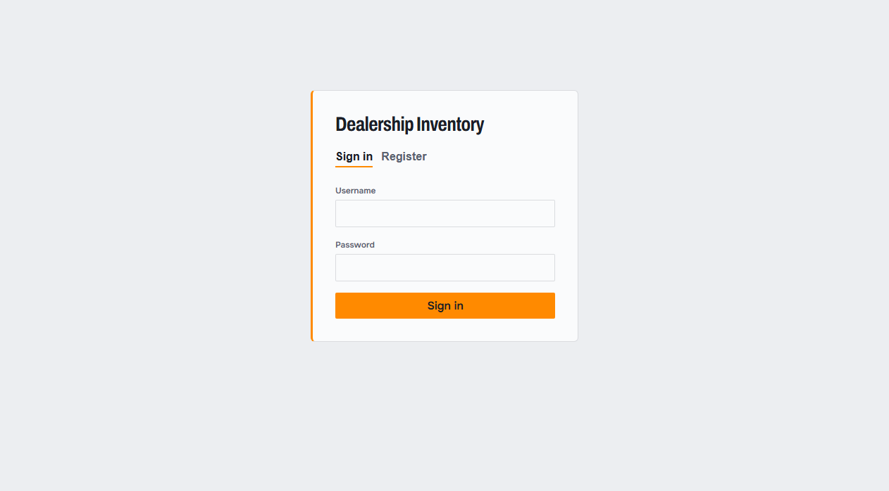
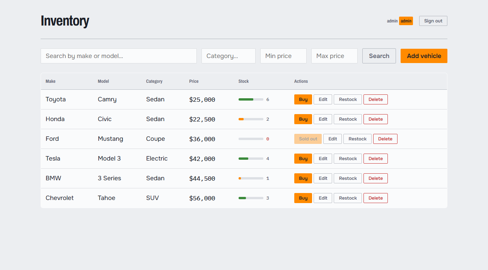
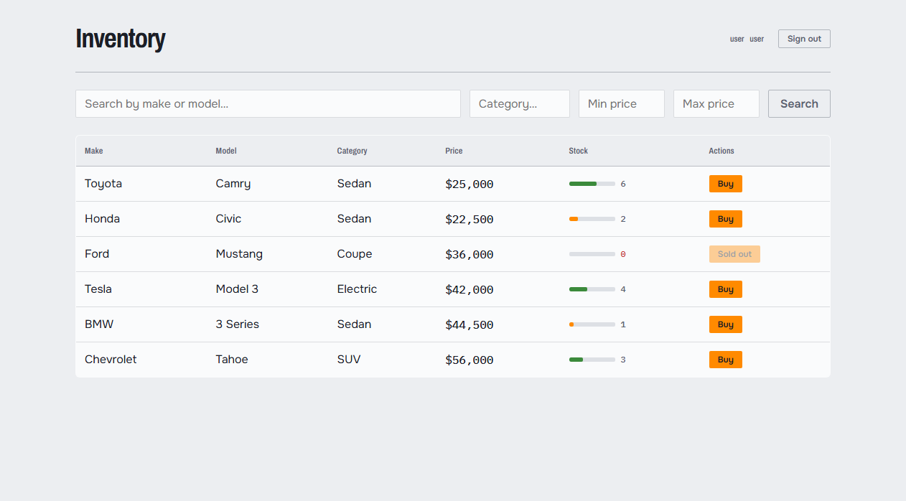

# Incubyte Car Dealership Inventory System — TDD Kata

A car dealership inventory management system built using strict Test-Driven Development (Red → Green → Refactor) for the Incubyte assessment.

[](https://github.com/DHYEYPATL/incubyte-car-dealership-tdd-kata/actions/workflows/ci.yml)
[](https://incubyte-car-dealership-tdd-kata.vercel.app/login)
[](https://incubyte-car-dealership-tdd-kata.onrender.com/)

---

## Live Demo

- **Live Application (Vercel)**: [https://incubyte-car-dealership-tdd-kata.vercel.app/login](https://incubyte-car-dealership-tdd-kata.vercel.app/login)
- **Backend API (Render)**: [https://incubyte-car-dealership-tdd-kata.onrender.com/](https://incubyte-car-dealership-tdd-kata.onrender.com/)
- **Interactive API Docs (Swagger UI)**: [https://incubyte-car-dealership-tdd-kata.onrender.com/docs](https://incubyte-car-dealership-tdd-kata.onrender.com/docs)
- **API Health Check**: [https://incubyte-car-dealership-tdd-kata.onrender.com/health](https://incubyte-car-dealership-tdd-kata.onrender.com/health)
- **GitHub Repository**: [https://github.com/DHYEYPATL/incubyte-car-dealership-tdd-kata](https://github.com/DHYEYPATL/incubyte-car-dealership-tdd-kata)

### Default Demo Credentials (Auto-seeded)
- **Admin**: Username: `admin` | Password: `admin123` *(Full inventory management: add, edit, delete, restock)*
- **User**: Username: `user` | Password: `user123` *(Browse stock & purchase vehicles)*
- Or register a brand new account directly on the login page!

---

## What It Does

- Register and log in as an **admin** (manage inventory) or **user** (browse and purchase)
- View all vehicles in a stock-sheet table with a **stock gauge bar** (green/amber/empty)
- Search vehicles by make, model, category, or price range
- Search via `GET /api/vehicles` (with params) or the dedicated `GET /api/vehicles/search`
- Purchase a vehicle — quantity decreases by 1; button disabled when out of stock
- Admin: add, edit, delete, and restock vehicles

---

## Stack

| Layer | Technology |
|-------|-----------|
| Backend | FastAPI + SQLAlchemy + SQLite |
| Auth | JWT via python-jose, bcrypt for password hashing |
| Frontend | React + Vite + Tailwind CSS |
| Backend tests | pytest + httpx TestClient |
| Frontend tests | Vitest + Testing Library |
| CI / CD | GitHub Actions (automated test runner for pytest & Vitest + keep-alive cron) |

---

## Setup and Run

### Requirements
- Python 3.13 (64-bit) — `py -3.13` or `python3.13`
- Node.js 18+

### Backend

```bash
# From repo root
py -3.13 -m venv backend/venv

# Windows
backend\venv\Scripts\activate

# Install dependencies
pip install -r backend/requirements.txt

# Run the server
uvicorn app.main:app --reload --app-dir backend
# Runs on http://localhost:8000
```

### Frontend

```bash
# From repo root
cd frontend
npm install
npm run dev
# Runs on http://localhost:5173 (proxies /api to backend)
```

Open http://localhost:5173 — register an account, then log in.

---

## Run Tests

### Backend tests (from repo root)

```bash
backend\venv\Scripts\python.exe -m pytest backend/tests/ -v
```

Result: **31 passed**

### Frontend tests (from frontend/)

```bash
cd frontend
npm test
```

Result: **35 passed**

---

## Screenshots

### Login / Register


### Inventory – User View


### Inventory – Admin View


### Out of Stock (Buy disabled)


---

## My AI Usage

**Tools used:** Kiro IDE (Claude) and Antigravity — used as a junior pair programmer.

**Workflow:**
1. I wrote the next small TDD step as a prompt
2. AI suggested the test or production code
3. I reviewed every line, ran the tests myself, and only then committed

**Key corrections I made:**
- Switched from passlib to direct bcrypt (compatibility issue)
- Fixed 32-bit Python / greenlet build failure by moving to Python 3.13 64-bit
- Caught a process violation (AI wrote frontend production code before failing tests) and corrected it with `git reset`

Every line of AI-generated code was reviewed. I can explain and modify any of it.  
Full interaction log is in `PROMPTS.md`.

---

## Note on early co-author trailers

> [!NOTE]
> **Contributor Attribution Notice**: In the first 9 commits (`f2d1f35` through `88071fa`), the commit messages followed the literal example snippet provided in `INCUBYTE_TDD_RULES.md` (`Co-authored-by: Kiro <AI@users.noreply.github.com>`). GitHub automatically maps the handle `<AI@users.noreply.github.com>` to the GitHub account `shimonenator` (Shimon Schwartz). Per strict Incubyte rules (*"Never rewrite history, never force-push"*), the Git history was kept intact. All commits and production code were authored by DHYEYPATL.
